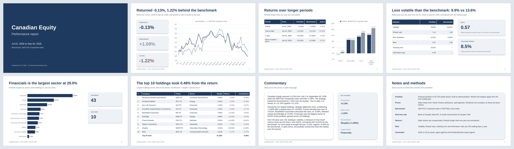
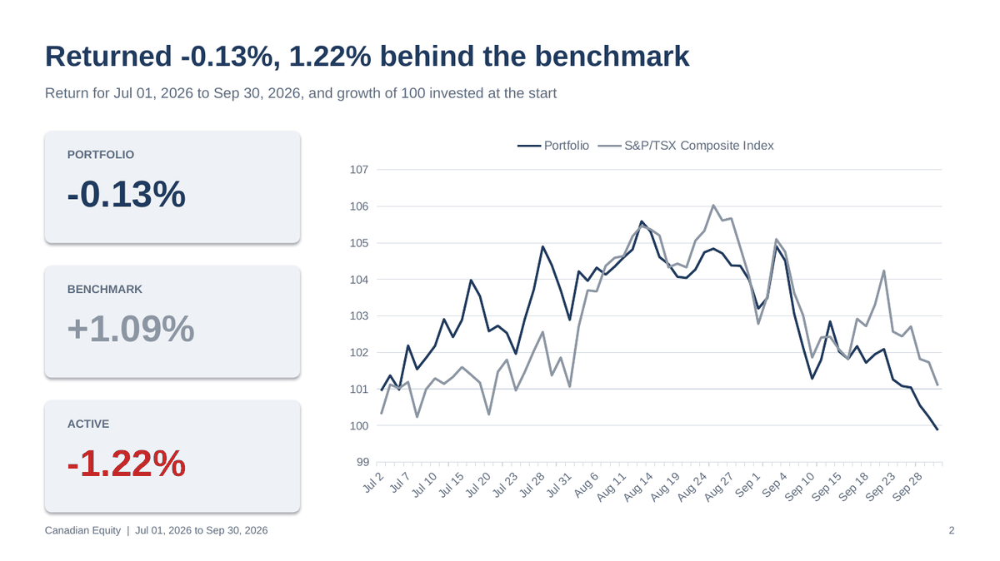
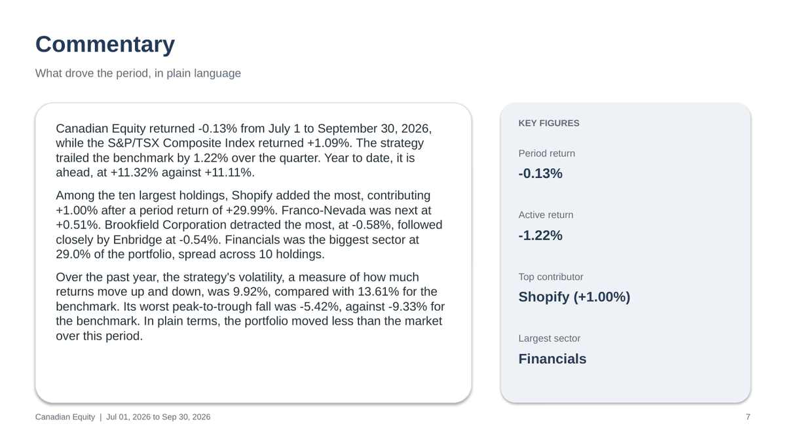
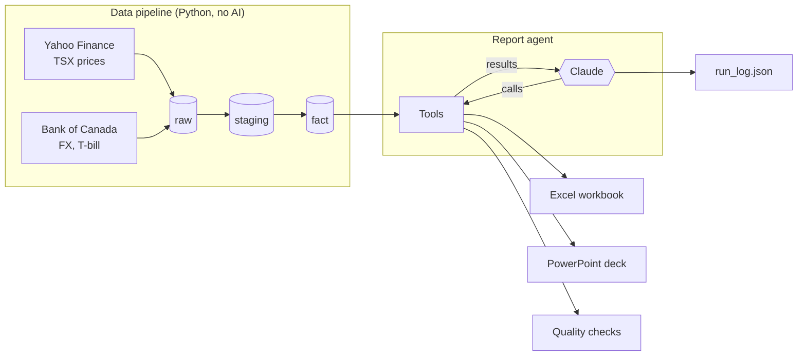

# Client Report Agent

[](https://github.com/Frobles26/client-report-agent/actions/workflows/ci.yml)

An AI agent that turns one plain-English request into a checked Excel workbook and PowerPoint client deck for an investment strategy, using real TSX market data in PostgreSQL.

```bash
python -m report_agent.agent.loop "Build the Q3 2026 client report for CAN_EQ"
```


Claude plans the work and calls tested Python tools. It never calculates a number: every figure comes from SQL and pandas, and any figure in its commentary that is not in the report is rejected before it reaches the deck. Seven quality checks run before a report counts as ready.

## What comes out

An eight-slide deck and a seven-tab Excel workbook, built from the same numbers. Below is the real Q3 2026 output.



Each slide title is written from the numbers, so it states the slide's point. Charts are native PowerPoint charts, so their data can be checked in PowerPoint.

| Performance | Commentary written by the agent |
|---|---|
|  |  |

The agent's summary at the end of that run (7 steps, about 23k input tokens):

```text
The strategy returned -0.13% for the quarter and the S&P/TSX Composite returned +1.09%.
The strategy trailed by 1.22%. Year to date it is slightly ahead, at +11.32% against +11.11%.
Checks: All checks passed, including data freshness, completeness, holdings weights and the
match between the files and the analytics.
```

## How it works



1. **Pipeline:** daily TSX closing prices (Yahoo Finance) and Bank of Canada exchange rates and 3-month T-bill yields (Valet API) are validated and loaded into PostgreSQL in layers: `raw` → `staging` → `fact`. Loads are upserts, so a rerun never duplicates rows, and every job is logged in `ops.runs`.
2. **Analytics:** returns, risk and attribution in pandas, tested against hand-worked values.
3. **Agent:** Claude turns the request into exact dates, then calls six tools: `get_data_status`, `get_report_numbers`, `build_excel`, `write_commentary`, `build_deck`, `run_quality_checks`.

## Design decisions

- **The model never calculates.** `get_report_numbers` returns every figure already formatted ("+1.20%"). `write_commentary` rejects any percentage or ratio that is not in those figures, and sends the error back to Claude so it can fix the text.
- **Checks before trust.** Seven checks cover the data and the files: weights add to 100%, prices are fresh and complete, every trading day has a return, no extreme moves, no stuck jobs, and the Excel and deck show the same numbers as the analytics. A fail means the agent may not call the report ready, and the command exits with an error.
- **Guardrails on the loop.** At most 15 steps per run. A period past the latest data is refused. API errors stop the run cleanly.
- **Audit trail.** Every step is saved to `output/run_log.json`: Claude's reasoning, each tool call with its input and result, the checks, and tokens used.
- **Live Excel.** Totals, active returns and contributions are formulas, and the Summary tab links to the detail tabs, so a reviewer can trace every number.
- **Tests without cost.** 65 pytest tests. The agent is tested with a fake Claude client that plays back scripted replies, so tests need no API key. GitHub Actions runs everything against a fresh PostgreSQL on every push.

**Stack:** Python 3.11, PostgreSQL 16, SQLAlchemy, pandas, NumPy, openpyxl, python-pptx, Anthropic API (tool use), Docker Compose, pytest, ruff, GitHub Actions.

## Run it yourself

Requirements: Python 3.11+, Git, and PostgreSQL (local with Docker, or a free cloud database such as Neon).

```bash
git clone https://github.com/Frobles26/client-report-agent.git
cd client-report-agent
python -m venv .venv
# Windows: .venv\Scripts\activate    macOS/Linux: source .venv/bin/activate
pip install -e ".[dev]"
cp .env.example .env          # Windows: copy .env.example .env, then add ANTHROPIC_API_KEY
docker compose up -d          # PostgreSQL on port 5433, schema loaded
```

No Docker? Put a cloud PostgreSQL connection string in `.env` as `DATABASE_URL=postgresql+psycopg://...` and run `python -m report_agent.setup_db`.

| Step | Command |
|---|---|
| Check the database | `python -m report_agent.db` |
| Create the sample portfolio | `python -m report_agent.etl.make_holdings` |
| Load market data (first run from 2024-01-01, then the last 10 days) | `python -m report_agent.etl.run_pipeline` |
| Print the numbers | `python -m report_agent.analytics.summary --start 2026-07-01 --end 2026-09-30` |
| Build the Excel workbook | `python -m report_agent.outputs.excel --start 2026-07-01 --end 2026-09-30` |
| Build the deck | `python -m report_agent.outputs.deck --start 2026-07-01 --end 2026-09-30` |
| Run the quality checks | `python -m report_agent.checks.quality --start 2026-07-01 --end 2026-09-30` |
| Ask the agent | `python -m report_agent.agent.loop "Build the Q3 2026 client report for CAN_EQ"` |
| Run the tests | `pytest` |

Files are saved in `output/`.

## Methods

- **Returns:** daily returns are compounded. Periods longer than one year are annualized. Month-end weights apply from the next trading day. All returns are price returns (dividends excluded) for both the portfolio and the index.
- **Risk:** measured over the year to the report end date, using 252 trading days. Volatility, Sharpe ratio (risk-free rate: Bank of Canada 3-month T-bill), max drawdown, beta, tracking error and information ratio.
- **Contribution:** start weight × the stock's return for the period.

The portfolio (43 TSX stocks, 11 sectors) is fictional. The market data is real and public. This is a demonstration project, not investment advice.

## Project layout

```
sql/                  schema (raw, dim, staging, fact, ops) and views
src/report_agent/
  etl/                extract, validate, load
  analytics/          returns, risk, weights, report data
  outputs/            Excel workbook and PowerPoint deck
  checks/             quality checks
  agent/              the agent loop and its tools
tests/                pytest
docs/                 screenshots and demo
```
